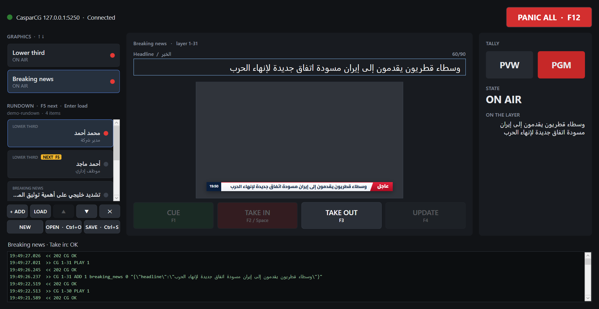
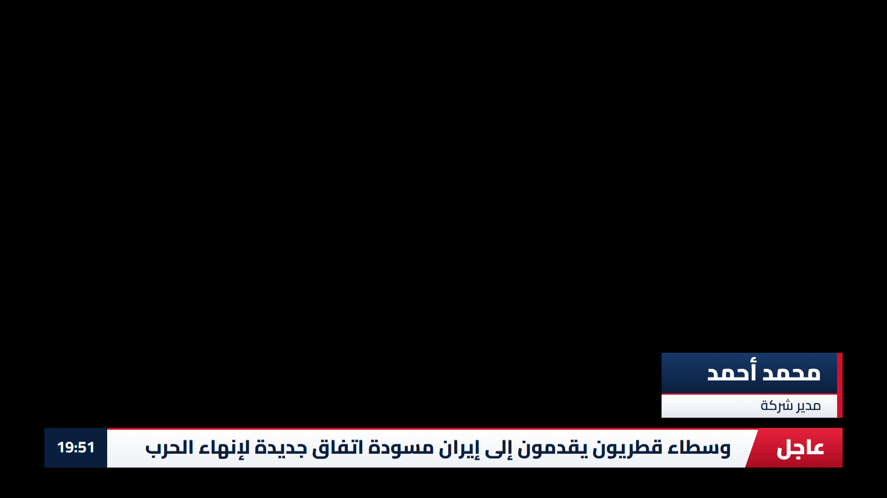
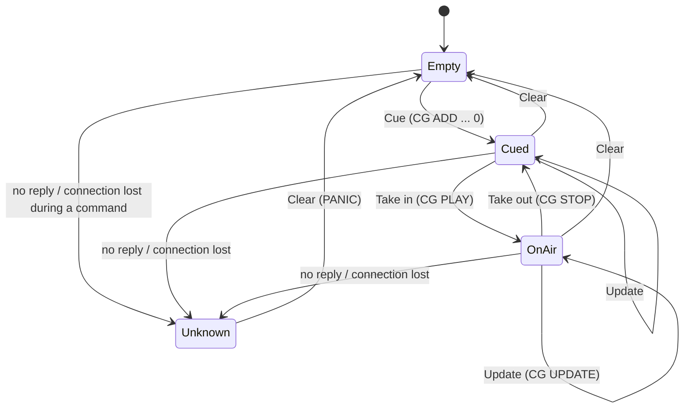
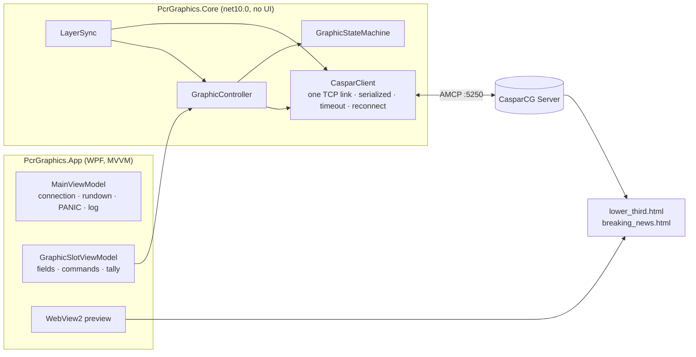

# PCR Graphics Controller

[](https://github.com/tariksalih412/pcr-graphics-controller/actions/workflows/ci.yml)

An on-air graphics control panel for a production control room (PCR), driving **CasparCG Server** over **AMCP**.
An operator cues, takes in, updates and takes out Arabic lower thirds and a breaking-news strap from a
keyboard-first WPF panel, with a live preview, a show rundown, and tally that only changes when CasparCG confirms.





Second project in a broadcast-developer portfolio, after
[live-sports-graphics-controller](https://github.com/tariksalih412/live-sports-graphics-controller)
(Python, API-Football data → CasparCG scorebug).

## Why it is built this way

In a PCR the panel must never show something different from what is on air. Everything follows from that rule:

- **Tally changes only on a 2xx reply.** A rejected command (4xx) keeps the state. No reply, or a lost
  connection, puts the layer in **UNKNOWN**, where the only allowed action is Clear.
- **One TCP connection, commands serialized**, 2 s timeout. A timeout closes the connection so a late reply
  can never be read as the answer to the next command. The client reconnects on its own and sends a
  `VERSION` heartbeat.
- **On every connect the panel asks CasparCG what is really on its layers** (`INFO 1`) instead of trusting
  its memory. See [Re-sync after a reconnect](#re-sync-after-a-reconnect).
- **A second press while a command is in flight is refused.** PANIC is never refused.
- **PANIC ALL clears only this app's layers** (1-30, 1-31), never the whole channel.

## Features

| | |
|---|---|
| Graphics | Lower third (layer 1-30: name, title) and breaking news (layer 1-31: headline), RTL Arabic |
| Workflow | Cue → Take in → Update → Take out → Clear, per layer, with per-layer tally (PVW / PGM) |
| Preview | The real HTML template rendered in WebView2, 16:9, updated while typing |
| Rundown | Prepare items before the show, reorder, save/open JSON, autosave, yellow **NEXT** badge |
| Safety | State machine with UNKNOWN, busy lock, PANIC, re-sync with CasparCG on every connect |
| Templates | Broadcast layout in safe areas, both graphics on air together, embedded font (works offline) |
| Release | One self-contained `PcrGraphics.App.exe` for Windows x64: no .NET install needed |

## Quick start

1. Install [CasparCG Server](https://github.com/CasparCG/server/releases) (tested with **2.5.1**,
   channel 1 at 1080i5000, AMCP on port 5250).
2. Download `PcrGraphics-v1.0.0-win-x64.zip` from [Releases](https://github.com/tariksalih412/pcr-graphics-controller/releases)
   and extract it anywhere.
3. Copy the templates into CasparCG's template folder:
   ```powershell
   Copy-Item templates\*.html "<CasparCG folder>\template\" -Force
   ```
4. Start CasparCG, then `PcrGraphics.App.exe`. Another server or port:
   ```powershell
   .\PcrGraphics.App.exe 192.168.1.50 5250
   ```

Requirements: Windows 10/11 x64 and the WebView2 runtime (already part of Windows 11).

## Operating

| Key | Action | AMCP |
|---|---|---|
| **F1** | Cue (loaded, hidden) | `CG 1-30 ADD 1 lower_third 0 "{json}"` |
| **F2** / **Space** | Take in | `CG 1-30 PLAY 1` |
| **F4** | Update text on air | `CG 1-30 UPDATE 1 "{json}"` |
| **F3** | Take out (back to cued) | `CG 1-30 STOP 1` |
| **F5** | Load the NEXT rundown item | – |
| **F12** | PANIC: clear this app's layers | `CLEAR 1-30`, `CLEAR 1-31` |
| **Esc** | Leave the text box (so Space takes in) | – |
| **Ctrl+S / Ctrl+O** | Save / open rundown | – |
| **↑ / ↓** | Select graphic | – |

Space only takes in outside a text box. Control buttons never take keyboard focus, so a hotkey always
acts on the selected graphic.

**NEXT** is what F5 loads: the item you clicked if it is not the one loaded last, otherwise the one after
it. If that item's graphic is on air, F5 only loads the text into the editor and the item stays NEXT.
The rundown autosaves to `Documents\PcrGraphics\autosave-rundown.json`.

## State machine



Transitions happen only on a 2xx reply. 4xx keeps the current state and shows the error.

## Re-sync after a reconnect

CasparCG can say **what** is loaded on a layer but not **whether a template is shown**: the HTML template
hides itself in JavaScript, so cued, on air and taken out produce identical `INFO` replies
(measured on 2.5.1, see [docs/casparcg-2.5.1-info-probe.txt](docs/casparcg-2.5.1-info-probe.txt)).
So on every connect the panel sends `INFO 1` once and applies these rules per layer:

| CasparCG reports | Panel state becomes |
|---|---|
| layer empty | **Empty** (e.g. CasparCG was restarted) |
| a different template or a video | **Unknown** |
| our template, and the link dropped while idle (heartbeat) | the last confirmed state (**Cued** / **On air**) |
| our template, and the link dropped while a command waited | **Unknown**: the command may or may not have run |
| our template, but the panel just started | **Unknown**: loaded by a previous session |

Reply formats found with the probe and handled by the client:
`201 INFO OK` is followed by a multi-line XML document ending with an empty line, and
`400 ERROR` is followed by one line echoing the rejected command.

## Templates

Both templates are 1920×1080 HTML, RTL, and implement the CasparCG HTML API (`update`, `play`, `stop`, `next`).

| | Zone (graphics-safe, 96 px from the sides, EBU R95) |
|---|---|
| Breaking news | bottom 66 px, height 86 px: label, headline, clock (playout machine time) |
| Lower third | bottom 174 px, i.e. above the breaking-news zone: both can be on air together |

- Name and title rows always share one width, so the block has no ragged edge.
- Long text shrinks to fit; a headline that still does not fit ends with “…”.
- Text changed on air is swapped with a short transition, not a full re-entrance.
- The **Cairo** font is embedded (subset to Arabic + Latin): no internet needed on the playout machine.
- Open a template in a browser with `?demo` to animate it, `?guides` to see the safe areas.

## Architecture



`PcrGraphics.Core` has no WPF dependency, so all the protocol and state logic is unit-tested on its own.

## Build from source

Requires the .NET 10 SDK.

```powershell
git clone https://github.com/tariksalih412/pcr-graphics-controller
cd pcr-graphics-controller
dotnet build PcrGraphics.slnx
dotnet test tests\PcrGraphics.Core.Tests
dotnet run --project src\PcrGraphics.App
```

Release build (tests, single-file publish, file check, zip):

```powershell
powershell -ExecutionPolicy Bypass -File tools\publish.ps1
# -> publish\PcrGraphics-v1.0.0-win-x64.zip
```

## Tests

79 xUnit tests in `tests/PcrGraphics.Core.Tests`, including an in-process fake AMCP server (`FakeCaspar`):
command formatting and escaping, reply parsing (including the real 2.5.1 INFO XML), timeouts that close the
connection, the full state machine, the busy lock, rundown save/load, and the re-sync rules.

## Tools

| | |
|---|---|
| `tools/PcrGraphics.Cli` | Terminal test bench: cue / take / update / clear / sync on layer 1-30 |
| `tools/probe_info.ps1` | Records CasparCG's raw `INFO` replies in each graphic state |
| `tools/amcp_proxy.py` | TCP proxy to cut the AMCP link without stopping CasparCG (re-sync tests) |
| `tools/mock_engine.py` | Minimal AMCP mock from project 1 |
| `tools/publish.ps1` | Builds the release zip |

## Project layout

```
src/PcrGraphics.Core/      Amcp/ (client, commands, replies, INFO parser)  Graphics/ (state machine, controller, sync, rundown)
src/PcrGraphics.App/       WPF panel: views, view models, WebView2 preview, crash.log handler
tests/                     xUnit tests + FakeCaspar
templates/                 lower_third.html, breaking_news.html, Cairo font licence
tools/                     CLI test bench, probe, proxy, publish script
docs/                      screenshots, CasparCG INFO probe output
```

## Limitations

- CasparCG only (no Viz, no Vizrt/Ross integration).
- One channel, two graphic layers; split screen with `MIXER FILL` is not implemented.
- After a reconnect, a layer can only be restored to Cued/On air if the link dropped while idle (see above).

## Licence

Code: MIT. The embedded Cairo font is under the SIL Open Font License 1.1 (`templates/OFL-Cairo.txt`).
